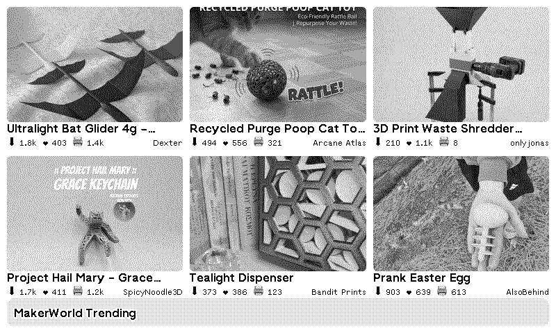

# [MakerWorld Trending Models](https://trmnl.com/recipes/272038?ref=mrlanrat)

Show trending 3D printing projects from [MakerWorld](https://makerworld.com/) on your TRMNL device.

## Description

This plugin displays trending models from MakerWorld, Bambu Lab's 3D model sharing platform.

## Settings

No custom settings required.

## Report a Problem

Something not working? [Open an issue](https://github.com/lanrat/trmnl_plugins/issues/new?template=bug_report.yml&plugin=MakerWorld%20Trending%20Models&title=%5BMakerWorld%20Trending%20Models%5D%20) and include a screenshot and your plugin settings.
