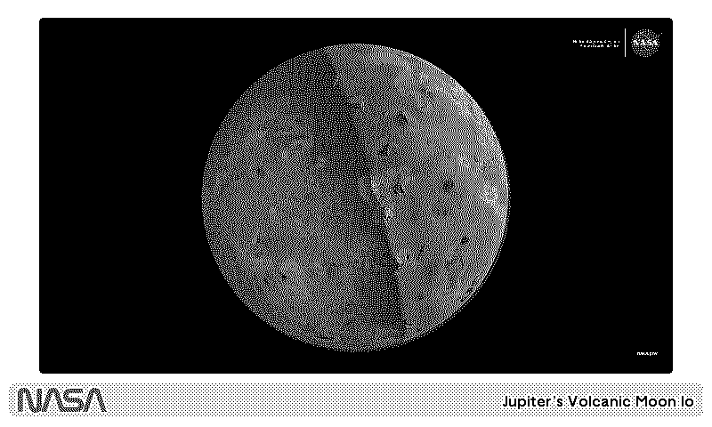

# [NASA Image of the Day](https://trmnl.com/recipes/76645?ref=mrlanrat)

Displays [NASA's Image of the Day](https://www.nasa.gov/image-of-the-day/) on your TRMNL device.

## Description

This plugin fetches and displays the latest featured image from NASA's Image of the Day feed, showcasing stunning space photography and astronomical imagery.

## Settings

No custom settings required.

## Report a Problem

Something not working? [Open an issue](https://github.com/lanrat/trmnl_plugins/issues/new?template=bug_report.yml&plugin=NASA%20Image%20of%20the%20Day&title=%5BNASA%20Image%20of%20the%20Day%5D%20) and include a screenshot and your plugin settings.
